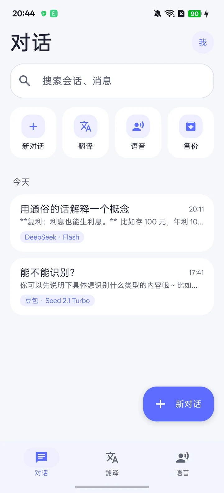
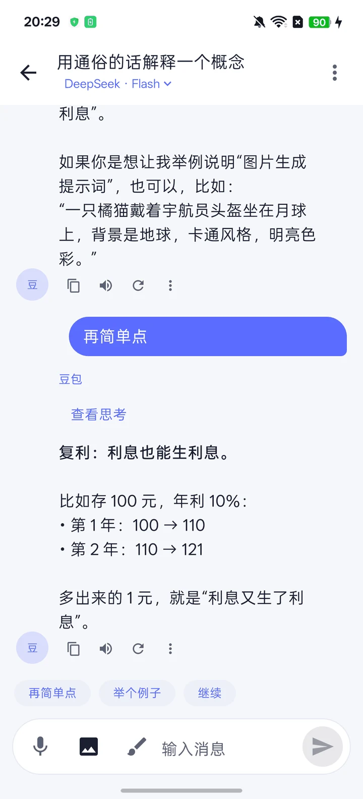
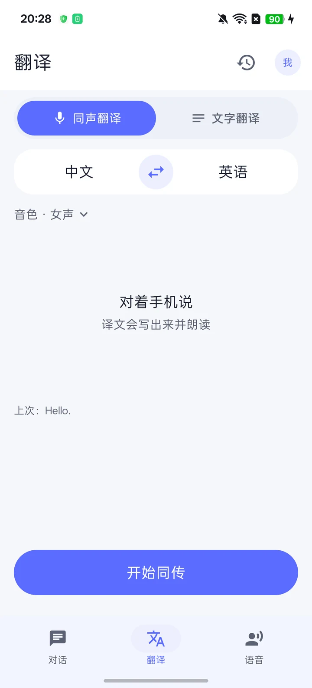
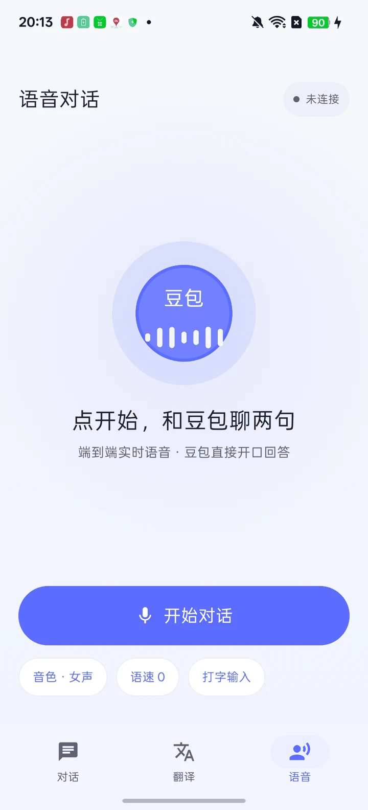
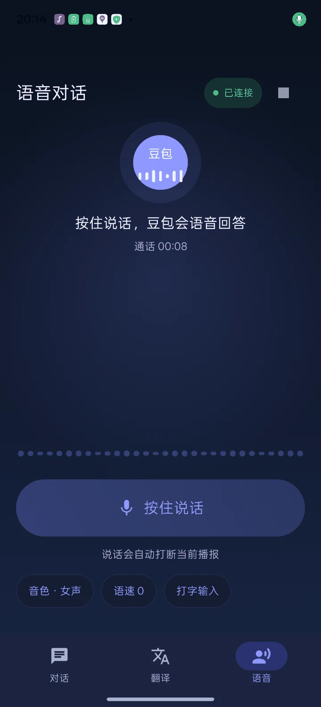
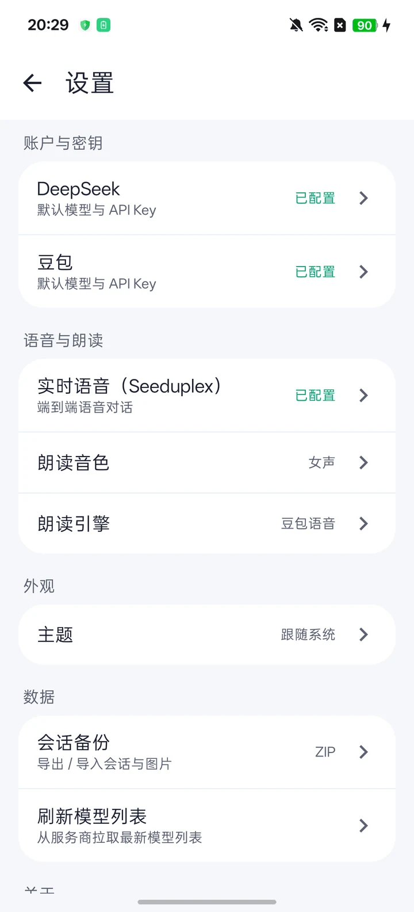
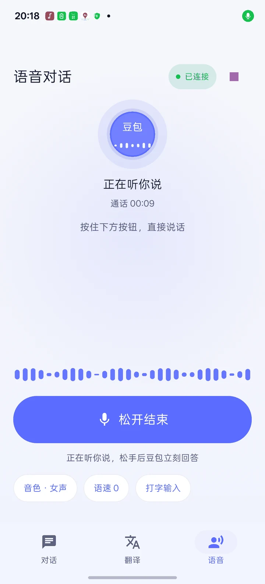
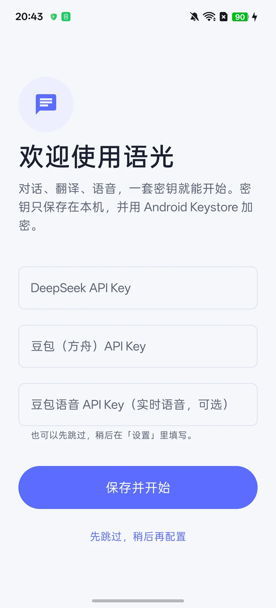

# 语光 · Lumo


Android 上的 AI 助手：和 DeepSeek、豆包（火山方舟）对话，做文字翻译与同声传译，还能直接和豆包**实时语音聊天**。三条主线共用一套本地加密的密钥即可开始。

`Android 7.0+` · `Kotlin 2.4` · `Jetpack Compose` · `Material 3` · `MIT`

- 包名：`com.yuguang.lumo`
- 版本：`1.0 (versionCode 1)`

---

## 界面预览

| 对话首页 | 聊天 | 翻译 |
|---|---|---|
|  |  |  |

| 实时语音（浅色） | 实时语音（深色） | 设置 |
|---|---|---|
|  |  |  |

| 语音聆听中 | 首次引导 |
|---|---|
|  |  |

底部三个 Tab：**对话 / 翻译 / 语音**，右上角头像进入设置。语音页与所有页面一样跟随系统深色模式。

---

## 功能

### AI 对话

- 多段对话保存在本机（Room），首页支持搜索、置顶、长按重命名 / 删除、快捷入口（新对话 / 翻译 / 语音 / 备份）。
- 流式回复；助手消息可展开思考过程，支持轻量 Markdown（代码块、列表、链接），可长按复制整段消息。
- 顶栏可编辑**助手人设**（系统提示词），内置预设或自定义，保存后从下一条消息生效。
- 模型按服务商分组选择，可从服务商**拉取最新模型目录**（本地缓存约 24 小时）；目录外模型 ID 可手动填写。
- 同一对话中途不换服务商；换模型只影响下一条消息。新建对话沿用最近一次成功发送的模型。
- 消息操作：复制、朗读、重试；快捷追问（再简单点 / 举个例子 / 继续）；新消息自动滚动跟随。

#### 识图与生图

- **发图识图**：最多 4 张，随文字发给支持视觉的模型；气泡内可点开大图。
- **AI 生图**：统一走豆包 **Seedream**（`/images/generations`），需要豆包方舟 Key（即使当前对话用 DeepSeek）。
  - 画笔画图模式：描述画面后发送，可附参考图做图生图；
  - 或输入明确画图意图（如「画一张…」）；
  - 豆包对话还会挂 `generate_image` 工具，由客户端执行并回显。
- 较新的用户附图会随上下文重放，更早的附图只保留文字，控制请求体大小。

### AI 翻译

同声翻译与文字翻译分开，记录各自保存。

- **文字翻译**：Seed Translation；输入或录音后自动翻译，也可点「翻译」立即翻译并写入记录。译文可复制、朗读；记录可回填编辑区。
- 听写输入支持按住说话、松开结束，并按文字脚本自动匹配源语言；与目标语相同则自动切换到中↔英另一侧。
- **同声翻译**：边说边出原文和译文，并由同传服务朗读译文；播放时麦克风不再回送播放声，避免重复翻译。
- 进行中不能切页或改语种；系统返回会先结束同传。
- **翻译记录**：按今天 / 昨天 / 日期分组，超过 6 条可搜索原文或译文；支持查看全文、复制、朗读、删除（删除前确认）。
- 错误提示已中文化（网络、鉴权、额度、模型不可用等）。

### 实时语音对话（Seeduplex）

- 接入豆包**端到端实时语音** `wss://openspeech.bytedance.com/api/v3/duplex/realtime/dialogue`，豆包直接语音回答，无需先识别再合成。
- **按住说话、松手发送**；播报中按住可直接打断当前回答。
- 中央光球随麦克风 / 播放音量律动，状态在待机 / 连接中 / 聆听 / 思考 / 播报之间切换。
- 实时字幕：你说 / 豆包两张卡片，最新一句高亮，长按复制。
- 通话计时；右上角红色「结束」按钮。
- **音色 / 语速热切换**：会话中修改通过 `session.update` 立即生效，不重连。
- **打字输入**：打招呼文字可直接让豆包朗读；配合实时语音会话使用。
- **自动降级**：未开通、403、网络异常或权限缺失时，自动切换为「识别 → 对话 → 朗读」链路，并在顶部显示黄色提示条。
- 底部导航是 Tab 语义：无返回箭头；系统返回键在通话中先挂断，未通话时离开语音 Tab。

### 朗读

- 对话、翻译与翻译记录可选择**豆包语音**或**本机朗读**；豆包语音可选女声 / 男声。
- 同声翻译的音色单独设置，不走全局朗读设置。
- 豆包朗读失败时，可对这一次改用本机朗读。

### 主题与外观

- 跟随系统 / 浅色 / 深色，设置内即时生效，所有页面同步。
- 统一设计令牌（颜色、圆角、字体、间距），语音页也随主题切换（浅色暖白 + 靛紫光晕，深色深空蓝 + 靛紫光晕）。

### 数据、备份与隐私

- 会话、消息、图片附件、翻译记录保存在本机 Room 数据库。
- 会话备份：导出 ZIP（含图片）、导入恢复；数据库迁移版本 v2 → v3 → v4。
- API Key 使用 Android Keystore 加密保存在本机，不写入源码、不上传第三方。
- 权限：`INTERNET`、`RECORD_AUDIO`；选图使用系统照片选择器，无需存储权限。

### 首次引导

首次启动进入引导页，可填写三个密钥（也可先跳过，稍后在设置里填写）；引导完成后不再出现。

---

## 服务商与密钥

| 服务商 | 默认地址 | 用途 |
|---|---|---|
| DeepSeek | `https://api.deepseek.com` | 对话（DeepSeek 模型），部分模型支持识图 |
| 豆包（火山方舟） | `https://ark.cn-beijing.volces.com/api/v3` | 对话、模型目录、Seed Translation、Seedream 生图 |
| 豆包语音 | 豆包语音控制台 | 语音识别、同声传译、朗读、实时语音对话（Seeduplex） |

- 豆包语音支持新版 `X-Api-Key`，也兼容旧版 **AppID + Access Token** 鉴权（朗读 / 同传 / 识别）。
- 实时语音需要账号开通 Seeduplex；未开通时应用会给出提示并自动降级。

---

## 快速开始

### 环境

- Android 7.0（API 24）及以上
- JDK 17
- Android SDK：`compileSdk` / `targetSdk` 37
- 构建链：AGP 9.4、Gradle 9.6、Kotlin 2.4.10、Compose BOM 2026.09.00

### 构建与安装

```bash
./gradlew :app:assembleDebug        # Windows 使用 gradlew.bat
./gradlew :app:testDebugUnitTest    # 单元测试
adb install -r app/build/outputs/apk/debug/app-debug.apk
```

在 `local.properties` 中配置本机 SDK 路径；首次打开后按引导填写密钥，或进入「设置 → 账户与密钥」。

### 下载与运行

调试包输出在 `app/build/outputs/apk/debug/app-debug.apk`。没有配置密钥也可以浏览历史会话、翻译记录与设置，但发送消息与语音功能需要对应密钥。

---

## 架构与技术栈

单模块 MVVM：Compose UI + ViewModel + Repository，Hilt 注入，Room 本地存储，OkHttp + kotlinx.serialization 处理网络。

| 层 | 选型 |
|---|---|
| UI | Jetpack Compose、Material 3、Navigation Compose |
| 状态 | ViewModel + `StateFlow`，收藏 / 设置用 DataStore 式 StateFlow |
| 依赖注入 | Hilt 2.60 |
| 本地存储 | Room 2.8（含迁移与 schema 导出）、文件媒体存储 |
| 网络 | OkHttp 4.12（HTTP/SSE）、原生 WebSocket（Seeduplex） |
| 序列化 | kotlinx.serialization 1.9 |
| 其他 | 协程 1.10、Activity Compose 1.13、Lifecycle 2.11 |

### 目录结构

```
app/src/main/java/com/yuguang/lumo/
├── data/
│   ├── local/        # Room 数据库、DAO、迁移、媒体文件
│   ├── remote/       # DeepSeek / 方舟 / 豆包语音 / Seeduplex / SSE 解码
│   └── ...           # 仓库实现、备份、设置
├── domain/           # 领域模型与仓库接口
├── di/               # Hilt 模块
├── ui/
│   ├── chat/         # 对话页与流式渲染
│   ├── translate/    # 文字翻译、同传、翻译记录
│   ├── voice/        # 实时语音对话（光球页面）
│   ├── list/         # 对话首页
│   ├── settings/     # 设置与子页面
│   ├── onboarding/   # 首次引导
│   ├── shell/        # 底部导航与页面骨架
│   ├── theme/        # 设计令牌与主题
│   └── ...
└── MainActivity.kt
```

### 关键链路

- **对话**：`/chat/completions` SSE 流式返回，增量渲染；支持思考过程折叠。
- **实时语音**：WebSocket JSON 事件（`session.create` / `session.update` / `input_audio_buffer.append` / `commit` / `mute` / `unmute` / `speech_text_buffer.commit` / `response.cancel`），下行 base64 PCM 24k 播放，上行 16k 单声道 20ms 帧。
- **语音识别 / 同传 / 朗读**：豆包语音 HTTP / WebSocket 接口。
- **生图**：Seedream `/images/generations`。

---

## 测试

- 单元测试：7 个文件、27 个用例（SSE 解码、流式渲染、协议解析、历史预算、语言规则、模型能力）。
- 仪器测试：数据库迁移 2 → 3（真机）。

```bash
./gradlew :app:testDebugUnitTest
./gradlew :app:connectedDebugAndroidTest   # 注意：会重装应用，先备份数据
```

---

## 数据迁移说明

项目早期版本的包名是 `com.example.myapplication`，现已迁移到 `com.yuguang.lumo`。包名变化意味着应用身份变化：

- 旧版本的本地数据不会自动出现在新包中；
- 迁移方式：旧版本「设置 → 数据 → 导出会话」得到 ZIP → 安装新包 → 「导入会话」恢复；
- API Key 用 Android Keystore 加密且与应用身份绑定，**无法迁移**，需要在设置中重新填写。

---

## 已知限制

- 方舟与豆包语音的模型 / 接口能力取决于账号开通情况；未开通时实时语音会降级，对话与翻译会给出中文错误提示。
- 同传与复刻原声的语言组合有限制：源语言或目标语言需包含中文或英文；复刻原声支持中、英、德、法、西、印尼、日、葡；粤语和上海话只能作为源语言。
- 同声翻译进行中不能切换页面或语种。
- 纯生图（Seedream）模型不会出现在对话模型选择列表中。

---

## 许可

[MIT License](LICENSE)

---

# 语光 · Lumo (English)

An Android AI assistant: chat with DeepSeek and Doubao (Volcengine Ark), translate typed text and live speech, and talk to Doubao over **end-to-end realtime voice**. Everything runs from one set of locally encrypted API keys.

`Android 7.0+` · `Kotlin 2.4` · `Jetpack Compose` · `Material 3` · `MIT`

- Package: `com.yuguang.lumo`
- Version: `1.0 (versionCode 1)`

## Preview

| Home | Chat | Translate |
|---|---|---|
|  |  |  |

| Realtime voice (light) | Realtime voice (dark) | Settings |
|---|---|---|
|  |  |  |

## Features

### Chat

- Local conversations (Room) with search, pinning, long-press rename/delete, and quick actions.
- Streaming replies, expandable reasoning, light Markdown, message copy / read-aloud / retry.
- Editable assistant persona (system prompt), model picker grouped by provider with a refreshable model catalog.
- Vision input (up to 4 images) and image generation via Doubao Seedream (draw mode, explicit intent, or a `generate_image` tool call).
- Quick follow-up chips and auto-scroll to new messages.

### Translation

- Seed Translation for text, Doubao simultaneous interpretation for live speech.
- Language-pair card, swap, automatic source-language matching from typed or recognized text.
- Translation records grouped by day with search, detail view, copy, read-aloud and delete.
- Microphone echo suppression while the interpreted speech is playing.

### Realtime voice (Seeduplex)

- End-to-end realtime voice over `wss://openspeech.bytedance.com/api/v3/duplex/realtime/dialogue`; Doubao answers with speech directly.
- Hold to talk, release to send; press while it is speaking to interrupt.
- Central orb reacts to microphone and playback levels; live captions for both sides.
- Call timer, red end button, and a Tab-style back behaviour (back ends the call first).
- Hot voice / speed switching during a call via `session.update`, no reconnect needed.
- Text greeting input, and automatic fallback to ASR → LLM → TTS when realtime voice is unavailable.

### Read-aloud

- Doubao TTS or the system TTS engine, with female / male voices for Doubao; a failed Doubao read can fall back to the system engine for that message.

### Theme & data

- System / light / dark theme applied to every screen, including the voice page.
- Session backup ZIP export / import (images included); Room migrations v2 → v3 → v4.
- API keys encrypted with Android Keystore and never committed.

## Providers

| Provider | Default endpoint | Used for |
|---|---|---|
| DeepSeek | `https://api.deepseek.com` | Chat (DeepSeek models), vision on supported models |
| Doubao (Ark) | `https://ark.cn-beijing.volces.com/api/v3` | Chat, model catalog, Seed Translation, Seedream images |
| Doubao Speech | Doubao Speech console | ASR, simultaneous interpretation, TTS, realtime voice (Seeduplex) |

## Build

```bash
./gradlew :app:assembleDebug
./gradlew :app:testDebugUnitTest
adb install -r app/build/outputs/apk/debug/app-debug.apk
```

Requires JDK 17 and Android SDK with compileSdk/targetSdk 37. Configure keys on first launch or under Settings → Account & keys.

## Architecture

Single-module MVVM: Compose UI + ViewModel + Repository, Hilt, Room, OkHttp + kotlinx.serialization. Modules: `data/local` (Room), `data/remote` (DeepSeek, Ark, Doubao Speech, Seeduplex, SSE), `domain`, `di`, `ui/{chat,translate,voice,list,settings,onboarding,shell,theme}`.

## Testing

- 7 unit-test files / 27 cases.
- Instrumented migration test 2 → 3.

```bash
./gradlew :app:testDebugUnitTest
./gradlew :app:connectedDebugAndroidTest   # reinstalls the app; back up data first
```

## Migration note

Earlier builds used `com.example.myapplication`; the app is now `com.yuguang.lumo`. Local data does not transfer automatically — export a backup ZIP from the old build and import it into the new one. API keys are bound to the app identity via Android Keystore and must be entered again.

## Limitations

- Provider features depend on your account's access; unavailable realtime voice falls back automatically.
- Simultaneous interpretation and voice cloning support a limited set of language combinations (source or target must include Chinese or English).
- Pure image-generation models are hidden from the chat model picker.

## License

[MIT](LICENSE)
